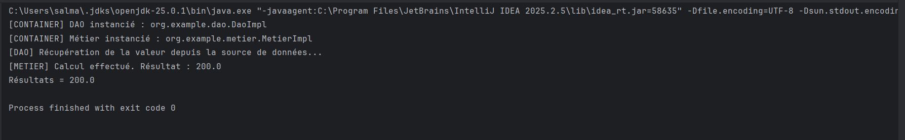

# Lab 3 : Programmation dynamique avec la réflexion Java

## Objectif
Charger dynamiquement des classes (DAO et métier) à partir d'un fichier de configuration `config.txt`, les instancier avec l'API de réflexion et injecter la dépendance DAO dans la couche métier via le setter `setDao`.

## Structure du projet
- `org.example.dao` : interface `IDao` et implémentation `DaoImpl`
- `org.example.metier` : interface `IMetier` et implémentation `MetierImpl`
- `org.example.presentation` : `Presentation2`, moteur de chargement dynamique
- `config.txt` : noms complets des classes à charger

## Contenu de config.txt
```
org.example.dao.DaoImpl
org.example.metier.MetierImpl
```

## Fonctionnement
1. Lecture des noms de classes dans `config.txt`
2. Chargement et instanciation avec `Class.forName()` et `Constructor.newInstance()`
3. Injection du DAO dans le métier avec `Method.invoke()` sur `setDao`
4. Appel de `calcul()` qui double la valeur renvoyée par le DAO

## Résultat de l'exécution
